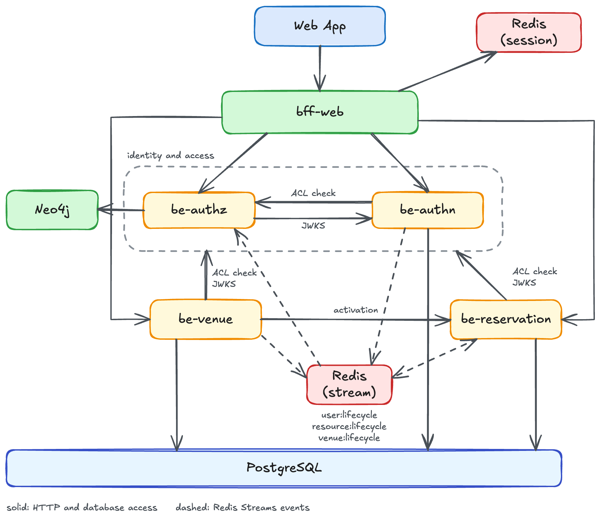

# RistOps

Restaurant operations platform. The system manages users, venues, reservation schedules and bookings,
and role-based access control across multiple services that communicate via HTTP and Redis Streams,
behind a GraphQL BFF consumed by a React web frontend.

## Running locally

Two Compose stacks cover development and the full containerized environment; neither needs a
`.env` file. See [Local Environment](deployment.md).

```bash
docker compose -f docker/docker-compose.yaml up -d --build      # everything in containers
docker compose -f docker/docker-compose.local.yaml up -d        # infrastructure only
```

## Services

| Service | Description |
|---------|-------------|
| [be-authn](services/be-authn.md) | User management and JWT issuance |
| [be-authz](services/be-authz.md) | ACL, role and permission management |
| [be-venue](services/be-venue.md) | Venue registry |
| [be-reservation](services/be-reservation.md) | Services, openings, closings and reservations |
| be-menu | Menus, sections and products (planned) |
| be-order | Orders, order items, states and courses (planned) |
| [be-chat](services/be-chat.md) | AI assistant chat: conversations and agent runs (in progress) |
| [bff-web](services/bff-web.md) | GraphQL BFF for the web frontend |

## Libraries

| Library | Description |
|---------|-------------|
| [ristops-lib-core](libraries/lib-core.md) | Shared foundation: context, settings, CLI, HTTP client, auth primitives |
| [ristops-lib-be](libraries/lib-be.md) | Backend-only helpers: auth middleware, stream event base types |
| [ristops-lib-sql](libraries/lib-sql.md) | SQLAlchemy async session management |
| [ristops-lib-redis](libraries/lib-redis.md) | Redis client and stream consumer |
| [ristops-lib-neo4j](libraries/lib-neo4j.md) | Neo4j async driver, transactions and migrations |
| [ristops-lib-otel](libraries/lib-otel.md) | OpenTelemetry instrumentation: traces, metrics and logs |
| [ristops-lib-agent](libraries/lib-agent.md) | Stateless LLM agent runtime: tool loop, HTTP tools, typed events (in progress) |

## Architecture



The same topology as text:

```text
browser
  └─► bff-web             (GraphQL + REST, Redis sessions)
        ├─► be-authn      (login, token refresh, user management — PostgreSQL)
        ├─► be-authz      (ACL checks, roles, resources — Neo4j)
        ├─► be-venue      (venue registry — PostgreSQL)
        └─► be-reservation (services, openings, closings, reservations — PostgreSQL)

be-authn  ──Redis stream──► be-authz        (user lifecycle events)
any svc   ──Redis stream──► be-authz        (resource lifecycle events)
be-venue  ──Redis stream──► be-reservation  (venue lifecycle events — local venue read model)
be-venue  ──HTTP──────────► be-reservation  (venue activation requires at least one service)
other svcs ──HTTP─────────► be-authn        (JWKS fetch, to verify JWTs locally)
authn, venue, reservation ──HTTP──► be-authz (ACL check on every authorized request)
```

Every service runs the same middleware stack: exception handling, request context
(request/correlation IDs), authentication, request logging. Services other than the BFF validate
JWT tokens by fetching JWKS from `be-authn`. Authorization checks are delegated to `be-authz`
via `AuthZInterceptor`.
