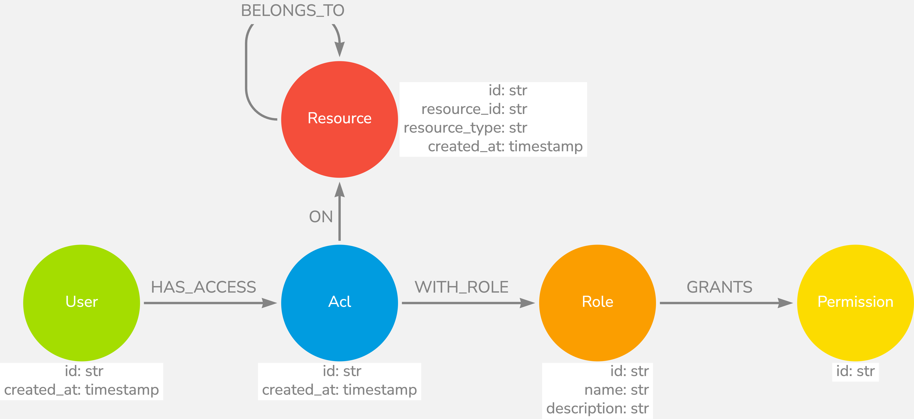

# be-authz

Authorization service. Manages ACLs, roles, and permissions in a Neo4j graph and answers
authorization check requests from other services.

> Source: [ristops-be-authz](https://github.com/pcrt1697/ristops/blob/main/ristops-backend/packages/ristops-be-authz/README.md)

## Graph model

A graph database is used because authorization requires hierarchy traversal: a user may have
access to a resource not because of a direct ACL entry, but because they have access to a parent
resource. Expressing and querying this in a relational model would require recursive CTEs; in a
graph it is a natural path traversal.

Resources are typed (`app`, `venue`, `user`, `role`, `acl`, `permission`) and form a hierarchy
via `BELONGS_TO`. Permission actions: `get`, `list`, `add`, `edit`, `remove`, `*` (manage).

## Authorization check flow

1. A service calls `be-authz` with a `CheckAuthorizationRequest` containing the user ID and the
   required grants (resource + permission pairs)
2. `be-authz` queries Neo4j for a path from the user to an ACL that covers the resource (or any
   ancestor) with a role that grants the permission
3. Returns `is_authorized: true/false`

The check is performed by `AuthZInterceptor` before every non-public request. Because the
check is centralised here, adding a new resource type or changing a role's permissions requires
no changes in the calling services.

## Roles, scope, and grant expiry

Access is granted by attaching a role to a user on a resource
(`(:User)-[:HAS_ACCESS]->(:Acl)-[:ON]->(:Resource)`, with `(:Acl)-[:WITH_ROLE]->(:Role)`).
Two properties shape how grants behave:

- **Role scope.** Each role declares a single `scope` — the resource *type* it may be assigned
  to (venue roles have `scope = venue`; `admin`/`developer` have `scope = app`; the auto-assigned
  `member` role has `scope = user`). `grant_access` rejects a grant whose resource type does not
  match the role's scope, and role listings can be filtered by scope so a UI only offers roles
  valid for the target resource. A single scope is enough because access inherits downward through
  `BELONGS_TO`: a role is assigned at its canonical level and cascades to sub-resources. This is
  distinct from a *permission's* scope — the prefix before `:` in an id like `venue:add`.

- **Grant expiry.** An ACL may carry an optional `expires_at`. Expired grants are excluded from
  both the authorization check and every grant listing
  (`acl.expires_at IS NULL OR datetime(acl.expires_at) > $now`). Re-granting the same
  (user, resource, role) updates the expiry. This supports time-bounded access (trials,
  contractors) without adding a deny mechanism to the otherwise additive model.

## Stream consumers

Rather than coupling `be-authz` to `be-authn` via a direct API call, user and resource lifecycle
events are published to Redis Streams. This keeps the services independent and makes the sync
resilient to temporary downtime — messages are replayed when the consumer recovers.

| Stream | Event | Action |
|--------|-------|--------|
| User stream | `created` | Creates a `User` node and a default member ACL |
| User stream | `deleted` | Removes the `User` node and all related ACLs |
| Resource stream | `created` | Creates `Resource` nodes with optional parent link |
| Resource stream | `deleted` | Removes the `Resource` node |

## Migrations

Schema and data changes are applied via `.cypher` files in
`src/ristops_be_authz/database/migrations/`, run in order by the `seed-authz` command.
Each applied migration is tracked as a `Migration` node in the graph. See
[ristops-lib-neo4j](../libraries/lib-neo4j.md) for the migration engine details.
